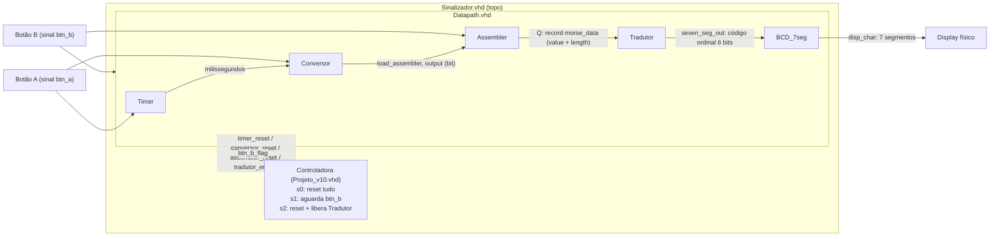

# Arquitetura

> Atualizado em 2026-11-16 após o merge que trouxe a reorganização de diretórios e a
> integração real do datapath feitas pelo Murilo. Os paths antigos (`maquina/...`,
> `testbench/...`) não existem mais no repositório.

## Padrão adotado: Datapath + Controladora + Sinalizador

Esse padrão, citado nos áudios como reaproveitado de um projeto de aula anterior,
**já está implementado de ponta a ponta** — diferente da versão anterior desta
documentação, em que `Sinalizador` era "[A DEFINIR]" e a `Controladora` "ainda não
orquestra o datapath real".

- **`Datapath/Datapath.vhd`** — entidade estrutural que instancia e conecta, em
  cadeia, os 5 componentes do datapath: `Timer` → `Conversor` → `Assembler` →
  `Tradutor` → `BCD_7seg`. Expõe sinais de reset individuais por componente
  (`timer_reset`, `conversor_reset`, `assembler_reset`), `tradutor_enable`, e os
  botões `btn_a`/`btn_b` como entradas; a saída é `disp_char` (7 segmentos) e
  `btn_b_flag` (eco do `btn_b`, usado pela Controladora).
- **`Controladora/Projeto_v10.vhd`** — máquina de estados Moore de **3 estados**
  (`s0`, `s1`, `s2`; entidade chamada `Projeto_v10`, não mais `Controladora`) que
  gera os sinais de reset/enable consumidos pelo `Datapath`:
  - `s0`: todos os resets ativos (`timer_reset`/`conversor_reset`/`assembler_reset`
    = `'1'`), `tradutor_enable = '0'` — estado inicial, limpa tudo.
  - `s1`: resets liberados (`'0'`), `tradutor_enable = '0'` — datapath livre para
    acumular símbolos Morse. Permanece aqui até `btn_b_flag = '1'`.
  - `s2`: resets voltam a `'1'` **e** `tradutor_enable = '1'` no mesmo estado —
    ou seja, no mesmo ciclo em que o caractere é "fechado" (botão B), a Controladora
    já começa a limpar os acumuladores do próximo caractere e libera o `Tradutor`
    para ler o resultado do caractere atual. Funciona porque o `Assembler` só reseta
    seu acumulador interno (`data_in`/`counter`) no sinal `Reset` — o registrador de
    saída `Q` (que o `Tradutor` lê) não é afetado por `Reset`. **Limitação:** esse
    acoplamento de tempo (reset e leitura do resultado no mesmo estado) não tem
    testbench cobrindo esse caso específico. Volta para `s1` em seguida.
- **`Sinalizador/Sinalizador.vhd`** — resolve a pergunta em aberto "qual é o papel do
  Sinalizador?" que ficava sem resposta nos áudios: é o **topo estrutural do
  projeto**, que instancia `Datapath` e `Controladora` (`Projeto_v10`) e fecha o laço
  entre os dois (liga os sinais de reset/enable gerados pela Controladora às entradas
  do Datapath, e `btn_b_flag` de volta da Datapath para a Controladora). É o ponto de
  entrada do sistema completo.

## Os 5 componentes do Datapath

| # | Componente | Pasta/arquivo no repo | Status |
|---|---|---|---|
| 1 | Timer | `Timer/Timer.vhd` | ✅ Implementado — mede duração do toque em ms. **Limitação:** sem perfis de velocidade configuráveis. Com testbench |
| 2 | Conversor | `Conversor/Conversor.vhd` | ✅ Implementado — decide ponto/traço comparando ms contra `tempo_ponto`/`tempo_traco`, com testbench. **Limitação:** toque mais longo que `tempo_traco` é ignorado silenciosamente |
| 3 | Assembler | `Assembler/Assembler.vhd` | ✅ Implementado, incluindo o par `(value, length)` (record `morse_data` em `Assembler/Assembler_pkg.vhd`) — fecha a pendência de zero-padding/comprimento registrada na versão anterior desta doc. Com testbench |
| 4 | Tradutor | `Tradutor/Tradutor.vhd` | ✅ Implementado — decodifica `(value, length)` em código ordinal de 6 bits para o `BCD_7seg`, cobrindo letras (length 1–4) e dígitos (length 5). Com testbench |
| 5 | Display | `BCD_7seg/BCD_7seg.vhd` (opção 7 segmentos) | ✅ 7 segmentos implementado, com mesma lógica de antes (entidade `Bcd_7seg`) · ❌ LCD 16x2 não implementado |

> 📺 **Display tem duas opções de hardware em aberto — ver seção dedicada abaixo.**

Não há componente genérico de registrador (`RegW`/`RegistradorGenerico`) no
repositório atualmente. A `Controladora` (`Controladora/Projeto_v10.vhd`, FSM de 3
estados) está integrada via `Sinalizador.vhd`, mas não tem testbench — ver
[`06-testbenches.md`](./06-testbenches.md).

## Diagrama de fluxo (estado real, 2026-11-16)

Esse diagrama substitui o anterior, que era inferência baseada só nos áudios — agora
reflete as portas e `port map`s reais de `Datapath.vhd`, `Sinalizador.vhd` e
`Controladora/Projeto_v10.vhd`.

## Display: 7 segmentos ou LCD 16x2

A etapa final (mostrar a letra decodificada) ainda tem duas opções de hardware
possíveis — isso não mudou:

| | 7 segmentos (`BCD_7seg.vhd`) | LCD 16x2 |
|---|---|---|
| Status | ✅ Implementado e integrado no `Datapath.vhd` | ❌ Não implementado |
| O que mostra | 1 caractere por vez (dígito ou aproximação de letra) | Texto real, várias letras em sequência (2 linhas x 16 colunas) |
| Interface elétrica | Combinacional simples: 6 bits de entrada → 7 bits de saída (`with select`) | Controlador tipo HD44780 — barramento de dados (4 ou 8 bits) + sinais de controle `RS`, `RW`, `E`, exige sequência de inicialização e temporização entre escritas |
| Esforço para implementar | Já pronto e integrado | Novo componente do zero: máquina de estados para inicializar o LCD, escrever comandos e caracteres, controlar posição do cursor |
| Limitação conhecida | Várias letras (M, W, X) não têm representação exata em 7 segmentos — o `Tradutor` e o `BCD_7seg` já assumem aproximações (ver código) | Nenhuma limitação de caractere (ASCII completo), mas usa bem mais pinos da FPGA |

## Projeto Quartus / síntese

**Limitação:** não há nenhum projeto Quartus (`.qpf`/`.qsf`) versionado no
repositório — nem por componente, nem um projeto unificado para o `Sinalizador`
como top-level. Compilar o projeto exige recriar o projeto Quartus e a pinagem a
partir dos arquivos `.vhd`.
