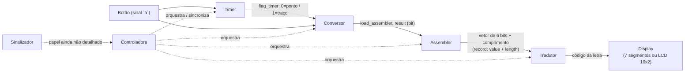

# Arquitetura

## Padrão adotado: Datapath + Controladora + Sinalizador

Segundo o primeiro áudio explicativo, o projeto segue o mesmo padrão de um exercício de
aula anterior, dividido em três camadas:

- **Datapath** — os componentes que efetivamente processam e carregam o dado (os 5
  componentes listados abaixo).
- **Controladora** — a máquina de estados que orquestra o datapath (pasta `maquina/Controladora/`,
  arquivo `Controladora.vhd` — já compila, mas ainda é um rascunho que não orquestra os
  componentes reais do datapath, ver pendências).
- **Sinalizador** — pasta `maquina/Sinalizador/` existe mas está vazia (`.gitkeep`). O papel exato
  não foi detalhado nos áudios além de ser citado como uma das três camadas; pelo nome,
  presume-se que seja responsável por algum tipo de sinalização/feedback (ex.: indicar ao
  usuário que um toque foi registrado, ou que o circuito está pronto para o próximo
  símbolo). **Isso é uma inferência, não uma confirmação** — validar com a equipe.

## Os 5 componentes do Datapath

Conforme descrito no primeiro áudio ("até agora a gente tem um timer, um conversor, um
assembler, um tradutor e um display"):

| # | Componente (áudio) | Pasta/arquivo no repo | Status |
|---|---|---|---|
| 1 | Timer | `maquina/datapath/Timer/` (só `gitkeep.txt`) | ❌ Não implementado |
| 2 | Conversor | `maquina/datapath/Conversor/Conversor.vhd` | ✅ Implementado, com testbench (`testbench/Conversor/tb_Conversor.vhd`) |
| 3 | Assembler | `maquina/datapath/Assembler/Assembler.vhd` | 🟡 Implementado parcialmente (falta zero-padding e campo de tamanho), com testbench (`testbench/Assembler/tb_Assembler.vhd`) |
| 4 | Tradutor | `maquina/datapath/Tradutor/` (só `.gitkeep.txt`) | ❌ Não implementado |
| 5 | Display | `maquina/datapath/BCD_7seg/BCD_7seg.vhd` (opção 7 segmentos) | ✅ 7 segmentos implementado, com testbench cobrindo toda a tabela (`testbench/BCD_7seg/tb_BCD_7seg.vhd`) · ❌ LCD 16x2 não implementado |

> 📺 **Display tem duas opções de hardware em aberto — ver seção dedicada abaixo.**

Além desses 5, existem dois componentes extras no repositório:

| Componente | Pasta/arquivo | Papel |
|---|---|---|
| Registrador genérico | `maquina/Reg_W/RegW.vhd` (entidade `RegistradorGenerico`) | Registrador parametrizável (largura `W`), com testbench. Reset padronizado como ativo em alto, igual aos demais módulos. Ainda não instanciado em nenhum outro módulo — parece ser um bloco reutilizável para uso futuro. |
| Controladora (rascunho) | `maquina/Controladora/Controladora.vhd` | Máquina de estados de 4 estados (`s0`..`s3`) — **já compila** e tem testbench (`testbench/Controladora/tb_Controladora.vhd`), mas a transição `s2 → s3 → s0` é só um fechamento sintático provisório; o papel real de cada estado no fluxo completo do datapath ainda não foi definido. |

## Diagrama de fluxo (planejado, conforme áudio)

> As setas do `Controladora` e o papel do `Sinalizador` são inferências baseadas no
> padrão "Datapath + Controladora + Sinalizador" descrito em áudio — as conexões
> exatas (quem instancia quem, quais sinais de controle existem) ainda não existem
> no código e precisam ser confirmadas/definidas pela equipe. O diagrama do datapath
> desenhado à mão pelo autor (mencionado no segundo áudio) ainda não foi adicionado
> ao repositório.

## Display: 7 segmentos ou LCD 16x2

A etapa final (mostrar a letra decodificada) tem duas opções de hardware possíveis,
com implicações bem diferentes de complexidade:

| | 7 segmentos (`BCD_7seg.vhd`) | LCD 16x2 |
|---|---|---|
| Status | ✅ Implementado | ❌ Não implementado |
| O que mostra | 1 caractere por vez (dígito ou aproximação de letra) | Texto real, várias letras em sequência (2 linhas x 16 colunas) |
| Interface elétrica | Combinacional simples: 6 bits de entrada → 7 bits de saída (`with select`) | Controlador tipo HD44780 — barramento de dados (4 ou 8 bits) + sinais de controle `RS`, `RW`, `E`, exige sequência de inicialização e temporização entre escritas |
| Esforço para implementar | Já pronto | Novo componente do zero: máquina de estados para inicializar o LCD, escrever comandos e caracteres, controlar posição do cursor |
| Limitação conhecida | Várias letras (M, W, X) não têm representação exata em 7 segmentos — o arquivo já assume aproximações (ver comentários no código) | Nenhuma limitação de caractere (ASCII completo), mas usa bem mais pinos da FPGA |

**O que muda no resto do datapath:** com 7 segmentos, o `Tradutor` precisa gerar o
*código ordinal* de 6 bits que o `BCD_7seg` já sabe decodificar (ver seção abaixo). Com
LCD 16x2, o `Tradutor` precisaria gerar o **código ASCII** da letra (8 bits), e um novo
componente (ex.: `LCD_16x2` ou similar, ainda não criado) ficaria responsável pelo
protocolo do controlador do LCD — um driver bem mais complexo que o `BCD_7seg` atual.

> 🟡 **Decisão em aberto:** ainda não está definido qual das duas opções a equipe vai
> seguir (ou se as duas serão suportadas, com o `Tradutor` escolhendo o formato de saída
> conforme o display conectado). Ver
> [`04-decisoes-e-pendencias.md`](./04-decisoes-e-pendencias.md).

## Por que o `Tradutor` e o `Display` parecem redundantes (caminho 7 segmentos)

O `BCD_7seg.vhd` já decodifica uma entrada de 6 bits para o padrão de 7 segmentos — mas
essa entrada de 6 bits é um **código ordinal sequencial** (`"000000"`=0, `"000001"`=1, ...,
`"001010"`=A, ... `"100011"`=Z), **não** o padrão de pontos/traços do Morse.

Ou seja, o `Tradutor` (ainda não implementado) é quem precisa:
1. Receber o par `(valor Morse de 6 bits, comprimento)` vindo do `Assembler`;
2. Decidir qual letra esse padrão Morse representa;
3. Converter essa letra para o código ordinal de 6 bits que o `BCD_7seg` já sabe
   decodificar.

Essa separação de responsabilidades é consistente com o padrão Datapath descrito, mas
só funciona quando o `Tradutor` existir.
