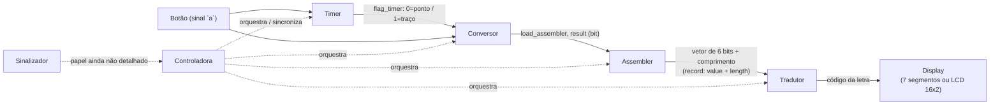

# Arquitetura

## Padrão adotado: Datapath + Controladora + Sinalizador

- **Datapath** — os componentes que efetivamente processam e carregam o dado.
- **Controladora** — a máquina de estados que orquestra o datapath (pasta `maquina/Controladora/`,
  arquivo `Controladora.vhd` — já compila, mas ainda é um rascunho, ver pendências).
- **Sinalizador** — pasta `maquina/Sinalizador/` [A DEFINIR]

## Os 5 componentes do Datapath

| # | Componente | Pasta/arquivo no repo | Status |
|---|---|---|---|
| 1 | Timer | `maquina/datapath/Timer/`  | ❌ Não implementado |
| 2 | Conversor | `maquina/datapath/Conversor/Conversor.vhd` | ✅ Implementado, com testbench |
| 3 | Assembler | `maquina/datapath/Assembler/Assembler.vhd` | 🟡 Implementado parcialmente (falta zero-padding e campo de tamanho), com testbench |
| 4 | Tradutor | `maquina/datapath/Tradutor/`  | ❌ Não implementado |
| 5 | Display | `maquina/datapath/BCD_7seg/BCD_7seg.vhd` (opção 7 segmentos) | ✅ 7 segmentos implementado, com testbench · ❌ LCD 16x2 não implementado |

> 📺 **Display tem duas opções de hardware em aberto — ver seção dedicada abaixo.**

Além desses 5, existem dois componentes extras no repositório:

| Componente | Pasta/arquivo | Papel |
|---|---|---|
| Registrador genérico | `maquina/Reg_W/RegW.vhd` (entidade `RegistradorGenerico`) | Registrador parametrizável (largura `W`), com testbench. Ainda não instanciado em nenhum outro módulo. |
| Controladora (rascunho) | `maquina/Controladora/Controladora.vhd` | Máquina de estados de 4 estados (`s0`..`s3`) — **já compila**, com testbench, mas o papel real de cada estado ainda não foi definido. |

## Diagrama de fluxo (planejado, conforme áudio)

> As setas do `Controladora` e o papel do `Sinalizador` são inferências baseadas no
> padrão "Datapath + Controladora + Sinalizador" descrito em áudio — as conexões
> exatas (quem instancia quem, quais sinais de controle existem) ainda não existem
> no código e precisam ser confirmadas/definidas pela equipe.

## Display: 7 segmentos ou LCD 16x2

A etapa final (mostrar a letra decodificada) tem duas opções de hardware possíveis,
com implicações bem diferentes de complexidade:

| | 7 segmentos (`BCD_7seg.vhd`) | LCD 16x2 |
|---|---|---|
| Status | ✅ Implementado | ❌ Não implementado |
| O que mostra | 1 caractere por vez (dígito ou aproximação de letra) | Texto real, várias letras em sequência (2 linhas x 16 colunas) |
| Interface elétrica | Combinacional simples: 6 bits de entrada → 7 bits de saída (`with select`) | Controlador tipo HD44780 — barramento de dados (4 ou 8 bits) + sinais de controle `RS`, `RW`, `E`, exige sequência de inicialização e temporização entre escritas |
| Esforço para implementar | Já pronto | Novo componente do zero: máquina de estados para inicializar o LCD, escrever comandos e caracteres, controlar posição do cursor |
| Limitação conhecida | Várias letras (M, W, X) não têm representação exata em 7 segmentos — o arquivo já assume aproximações (ver comentários no código) | Nenhuma limitação de caractere (ASCII completo), mas usa bem mais pinos da FPGA |

